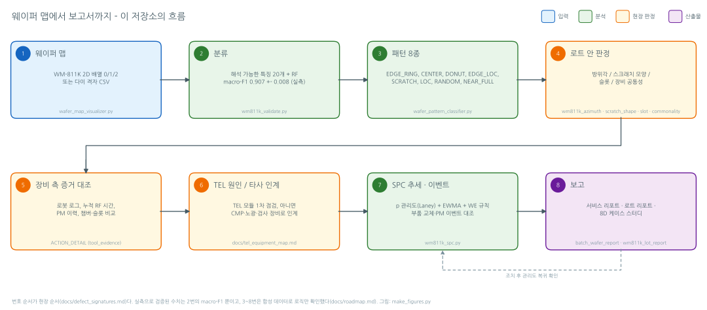

# 웨이퍼 맵 결함 시그니처 → 장비 원인 → 추세 감시

실측 웨이퍼 맵 25,519장(WM-811K)에서 결함 패턴 8종을 판별하고(macro-F1 0.907 ± 0.008, 로트 분할 5회), 각 패턴을 TEL 장비 모듈의 점검 순서·장비 측 증거·타사 인계 기준에 연결하고, 판정 위에 SPC 관리도를 붙여 추세의 시작점을 찾는 도구. 장비사 기술지원 엔지니어 시점으로 쓴 포트폴리오다. English: [`docs/README_en.md`](docs/README_en.md).

## Summary (EN)

- **Problem.** A die-level pass/fail wafer map is the accumulated result of every process step. An equipment vendor's technical support engineer sees such a map only when the customer escalates, and must narrow "is it our tool, or a hand-off to another vendor's tool?" with tool-side evidence (alarm logs, part counters, PM history) rather than the map alone.
- **Data.** WM-811K (Wu, Jang & Chen 2015): 25,519 labeled defect wafers in 8 classes, 8,047 lots, 329 map sizes (lot and size counts computed here). The 2 GB source file is not committed; 'none' (normal) wafers are excluded.
- **Method.** 20 interpretable features: 6 global radial/angular statistics, 11 structural (connected components, angular coverage, radial profile), 3 largest-component position features, plus a random forest. Lot-level group split repeated over 5 seeds; thresholds tuned on train lots only; macro-F1 over the 8 defect classes.
- **Result.** Rule-based 0.167 (uncalibrated) → 0.558 (calibrated) → RF 0.907 ± 0.008 (train 0.99). Per-class F1 from 0.83 (SCRATCH) to 0.98 (EDGE_RING, NEAR_FULL). The synthetic self-check (7/7) is a coding check, not a performance number.
- **What the diagnosis showed.** The synthetic-to-real collapse was a threshold problem, not a feature problem (single-feature AUCs were already high); thin scratches needed connected-component features; the remaining EDGE_LOC/LOC confusion needed largest-component position; one design assumption (RANDOM = many small components) was wrong and is recorded as such.
- **SPC.** Per-pattern p-charts on the classifier output with Laney p' overdispersion correction, Western Electric rules, EWMA and Phase I/II limits, stratified by chamber/slot (`--group-col`) and overlaid with PM/part-replacement events (`--event-col`). Rising alarms are attached to the per-pattern check list. Demo only: WM-811K rows are not in time order.
- **Field modules.** A per-pattern action playbook (`ACTION_DETAIL`: first checks, what to rule out first, customer-side vs tool-side evidence, TEL modules, hand-off to non-TEL tools), lot-level azimuth / scratch-shape / slot / tool-commonality analyses, a lot troubleshooting PDF and a service-report PDF. All verified on synthetic data only (logic, not performance).
- **Limits.** WM-811K has no timestamps, tool/chamber IDs, slot or probe-site information; notch orientation is an assumption; the defect subset averages 3.2 wafers per lot, so most lot-level tests return "insufficient"; equipment descriptions are public-source level and TEL internals or PM intervals are unknown.



그림·샘플 PDF는 전부 합성 데이터로 `make_figures.py`가 만든다([`docs/img/README.md`](docs/img/README.md)).

## 직무와의 연결

2026 하반기 공채 직무명 **Software Engineer - Tech Support Engineer** 기준으로 쓴다. 경력 Field / Process Engineer 트랙에서도 같은 표로 읽히도록 두 관점으로 나눴다. 1인 프로젝트이며 협업 구조는 공개 자료 기준의 설계다([`docs/handoff.md`](docs/handoff.md)).
<!-- 공고의 담당업무 문장은 소유자가 원문을 확인한 뒤 docs/references.md D절에 인용·확인일을 적고 아래 행에 1:1로 연결할 것. 원문 확인 전에는 인용하지 않는다. -->

| 업무 | 현장 기술지원 관점 | 설비 데이터·소프트웨어 관점 |
|---|---|---|
| 트러블슈팅 절차 | [`docs/defect_signatures.md`](docs/defect_signatures.md) 패턴별 점검 순서·고객 측/장비 측 증거·인계 판정, `python wafer_pattern_classifier.py --actions <PATTERN>`, [`docs/process_context.md`](docs/process_context.md) 서브시스템·안전 체크 | `wm811k_lot_report.py`(로트 판정·의심 모듈 순위·OCAP 레벨), `wm811k_azimuth.py` / `wm811k_scratch_shape.py` / `wm811k_slot.py` |
| 보고서·작업지시서 | `batch_wafer_report.py` 서비스 리포트 양식([`docs/img/service_report_page.png`](docs/img/service_report_page.png)), 보고 3단계([`docs/handoff.md`](docs/handoff.md)), 8D 케이스 2건([`docs/case_study_8d.md`](docs/case_study_8d.md)) | `wm811k_spc.py`의 알람 요약 `spc_<stem>_report.md`, `wm811k_lot_report.py` PDF + JSON, 두 리포트의 `--anonymize` |
| 추세 감시·예방보전 | 상승 알람 → 점검 항목·대조할 장비 측 로그, SEMI E10 관점(비예정 정지 → 예정 정지)([`docs/spc.md`](docs/spc.md)) | `wm811k_spc.py`: Laney p′, Western Electric 4규칙, EWMA, `--group-col`, `--event-col`, 저신뢰 관리도(모델 감시) |
| 본사·해외 협업·인계 | TEL 원인 vs 타사 인계 기준, 8D 팀 역할([`docs/handoff.md`](docs/handoff.md)), 한/영/일 용어 대조([`docs/glossary.md`](docs/glossary.md)) | [`docs/README_en.md`](docs/README_en.md), 리포트 `--lang en`, 장비 측 데이터(TELeMetrics·Ingenio 쪽)와의 결합 키([`docs/tel_equipment_map.md`](docs/tel_equipment_map.md) 3절) |
| 설비 개선·자동화 | 검증 범위와 남은 항목([`docs/roadmap.md`](docs/roadmap.md)), `make_figures.py` 한 명령으로 산출물 재생성 | `tests/` 13개 파일(합성만) + CI 매트릭스(ubuntu/windows × Python 3.11/3.12), 특징값 스냅샷(수치 불변 감시), `wm811k_commonality.py` + [`docs/lot_history_schema.md`](docs/lot_history_schema.md) |

## 맵 한 장이 들어왔을 때

[`docs/defect_signatures.md`](docs/defect_signatures.md)의 현장 순서와 같다. 3~7단계는 WM-811K에 시각·챔버·슬롯·장비 이력이 없어 합성 데이터(`--demo`)로 로직만 확인했다.

1. **에스컬레이션 수신·맵 판정.** 빈 맵, 로트 이력(어느 TEL 챔버를 언제 거쳤는가), 재테스트 여부를 받는다. 플레이북: `python wafer_pattern_classifier.py --actions EDGE_RING`, 로트 묶음 리포트: `python batch_wafer_report.py --anonymize`.
2. **테스트 원인 배제.** NEAR_FULL과 격자 주기 반복 패턴은 프로브 카드·테스트 프로그램이 만들 수 있다. 재테스트가 가장 싸다(`--actions NEAR_FULL`의 rule_out_first). 프로버가 Precio / Prexa면 TEL 프로버 점검이 함께 간다.
3. **로트 안에서 반복되는가.** 로트 전체면 공정 조건·장비 상태, 한 장이면 핸들링·이벤트: `python wm811k_lot_report.py data/wm811k_defects.pkl --pred test_predictions.csv --lot <lot>` (`--demo`). 배치 장비(TELINDY PLUS, EXPEDIUS)는 슬롯 위치별 비율: `python wm811k_slot.py test_predictions.csv --pattern EDGE_RING`.
4. **노치 기준 방위각 / 스크래치 모양.** 같은 각도면 챔버 고정 요소, 제각각이면 핸들링: `python wm811k_azimuth.py --demo`; 직선(반송계)인지 호(CMP, 타사)인지: `python wm811k_scratch_shape.py --demo`. 노치 방향은 `--notch-deg` 가정이다.
5. **장비 측 증거 대조.** 알람·이벤트 로그, 부품 누적 카운터(엣지 링 RF 시간, 시즈닝 후 매수), 레시피·PM 이력, 로봇 티칭 로그, ESC He 압력·존 온도를 해당 로트 처리 시각에 맞춰 꺼낸다: `ACTION_DETAIL[pattern]["tool_evidence"]`.
6. **공통성 분석.** 불량 로트들이 공유한 장비·챔버: `python wm811k_commonality.py test_predictions.csv --history lot_history.csv --pattern EDGE_LOC` (`--demo`).
7. **언제부터인가.** 패턴 발생률 관리도에 부품 교체·PM 이벤트를 겹친다: `python wm811k_spc.py test_predictions.csv --time-col <t> --event-col <event> --group-col chamber` (`--demo`). 시작점이 이벤트와 겹치면 그것이 답이다.
8. **TEL 원인 / 타사 인계 판정 → 보고.** `ACTION_DETAIL[pattern]["handoff"]` 기준으로 판정하고 초동 → 중간 → 종결 보고([`docs/handoff.md`](docs/handoff.md)). 끝까지 수행한 합성 사례: [`docs/case_study_8d.md`](docs/case_study_8d.md).

## 결과 요약

| 단계 | 특징 | macro-F1 (test 로트, 결함 8종) |
|---|---|---|
| 규칙 (train 로트에서 임계값 교정) | 전역 6 | 0.558 (미교정 0.167) |
| **랜덤포레스트** | **전역 + 구조 + 위치 20** | **0.907 ± 0.008** (로트 분할 5회, train 0.99) |

클래스별 F1(20개 특징, 5회 평균): CENTER 0.97 · EDGE_RING 0.98 · NEAR_FULL 0.98 · EDGE_LOC 0.91 · RANDOM 0.90 · DONUT 0.86 · LOC 0.84 · SCRATCH 0.83. 중간 단계 9행, 진단 과정 7단계, 설계 원칙, 수치 불변 규칙은 [`docs/validation_log.md`](docs/validation_log.md), 재현 근거는 [`results/`](results/README.md).

## 파일

| 파일 | 역할 |
|---|---|
| `wafer_pattern_classifier.py` | 규칙 분류기 8종 + 조치 플레이북 `ACTION_DETAIL`(코드·문서·리포트의 단일 소스). `--actions <PATTERN>` |
| `wafer_map_visualizer.py` | 합성 웨이퍼 맵 생성·렌더, WM-811K 2D 배열 → 다이 DataFrame 변환 |
| `wm811k_evaluate.py` | 미교정 규칙 실측 평가, 특징 AUC, 로트 크기 분포, `wm811k_predictions.csv` 저장. `--with-none` |
| `wm811k_calibrate.py` | 임계값 교정(train 로트만) + 결정트리·RF 기준선 비교 |
| `wm811k_structural.py` | 구조 특징 11개(연결 성분·각도 커버리지·반경 프로파일) 추가와 비교 |
| `wm811k_validate.py` | 로트 분할 5회 반복 검증, 위치 특징 3개, RF 규제 선택. `--export-predictions` → `test_predictions.csv` |
| `wm811k_improve.py` | 강건 특징 8개 + HistGradientBoosting, 같은 5분할에서 짝지어 비교(실측 미측정) |
| `wm811k_spc.py` | 분류 결과 위 SPC: 패턴별 p 관리도(Laney), 저신뢰 관리도, WE 규칙, EWMA, `--group-col` / `--event-col` / `--anonymize` / `--lang`, 알람 요약 md |
| `wm811k_azimuth.py` | 로트 안 EDGE_LOC/LOC 위치가 노치 기준 같은 각도인가(Rayleigh, 순열 p). `--notch-deg` |
| `wm811k_scratch_shape.py` | 스크래치 직선/호 판별(직선·원 적합)과 로트 내 방향 재현성 |
| `wm811k_slot.py` | 슬롯(waferIndex 대리) 의존성: 끝 슬롯 2×2, 로트 층화 순열, Spearman |
| `wm811k_commonality.py` | 로트 이력 CSV로 장비·챔버 공통성 분석(단계 내 Fisher, BH, 라우팅 중복률) |
| `wm811k_lot_report.py` | 로트 트러블슈팅 리포트 PDF + JSON: 믹스·반복·방위각·모양·슬롯·공통성·의심 모듈·OCAP·8D D2 초안 |
| `batch_wafer_report.py` | 배치 PDF + 로트별 1페이지 서비스 리포트 양식. `--lang en`, `--anonymize`, `--service-report` |
| `plotly_wafer_heatmap.py` | 파라메트릭(두께·CD) 맵 자기완결 HTML(오프라인). `--csv`(die_x, die_y, value) |
| `prepare_wm811k.py` | LSWMD.pkl → 라벨 있는 웨이퍼 추출. `--sample N`(로트 단위) |
| `make_figures.py` | `docs/img`·`docs/samples`의 그림·샘플 PDF를 합성 데이터로 재생성. `--only`, `--lang en` |
| `_fonts.py` | matplotlib 한글 폰트: 동봉 NanumGothic 우선 → 시스템 폰트 → 경고 1회 |
| `PORTFOLIO.md` | 증명하는 범위 / 못 하는 범위, 이 저장소로 답하는 기술 질문 6개 |
| `docs/defect_signatures.md` | 패턴 8종: 메커니즘, TEL 모듈 / 타사 인계, 고객 측·장비 측 증거, 점검 순서, 오분류의 현장 비용, 현장 순서 |
| `docs/tel_equipment_map.md` | 공정 분야 → TEL 현행 제품 → 소모품·PM(추정 표시) → 패턴, TEL 소프트웨어 쪽 데이터와의 결합 키 |
| `docs/process_context.md` | 8대 공정별 맵 시그니처, 장비 서브시스템 6개, 현장 점검 전 안전·클린룸 체크리스트 |
| `docs/handoff.md` | TEL 원인 vs 타사 인계 기준, 고객 보고 3단계, 8D 팀 역할, 고객 데이터 기밀 원칙 |
| `docs/case_study_8d.md` | 합성 8D 케이스 2건(EDGE_RING 드리프트, SCRATCH 계단): 타임라인, 5-why, 보고 예문, 조치 후 복귀 |
| `docs/spc.md` | SPC 상세: 발생률/점유율, 자동 부분군, Laney, EWMA 파라미터 근거, 데모 탐지 시점·허위 알람, 열 사전 |
| `docs/validation_log.md` | 실험 0~8 기록(가설 → 스크립트 → 수치 → 결론), 설계 원칙, 수치 불변 규칙 |
| `docs/roadmap.md` | 기능별 검증 범위(실측 / 합성 / 미측정) 표와 남은 항목 |
| `docs/glossary.md` | 장비·결함·품질·통계 용어 한/영/일 대조(미확인은 비워 둠) |
| `docs/lot_history_schema.md` | 공통성 분석 입력 CSV 스키마(가상 ID 예시) |
| `docs/references.md` | 외부 주장의 출처·확인일·확인 수준(공식 / 특허 / 논문 / 보도 / 추정) |
| `docs/README_en.md` | 영문 전체 요약(파일·실행·결과·현장 순서·패턴 표·SPC·한계) |
| `docs/img/`, `docs/samples/`, `docs/fonts/` | 합성 그림·흐름도, 샘플 PDF 2부, NanumGothic(SIL OFL 1.1) |
| `tests/synthetic_wm811k.py` | 합성 웨이퍼로 LSWMD.pkl 형식 데이터 생성(모든 테스트·데모의 공통 생성기) |
| `tests/test_pipeline.py` | 특징 방향 검증 + prepare → improve 전체 파이프라인 스모크 |
| `tests/test_features_snapshot.py` | 고정 맵 3장 × 28특징 스냅샷 — README 수치 불변 규칙의 CI 감시 |
| `tests/test_actions.py` | ACTION_DETAIL 구조·공정 물리 교정·제품명 표기·cp949 인코딩 검사 |
| `tests/test_exports.py` | 예측 CSV 내보내기, evaluate/calibrate 분할 일치, `--sample`, 규칙 동치, calibrate/structural 스모크 |
| `tests/test_spc.py` | WE 규칙·EWMA·Laney·부분군·발생률/점유율·데모 탐지 창·층화·이벤트 거리·익명화 |
| `tests/test_azimuth.py` | 각도 규약, Rayleigh(순열 p), 로트 판정, 로즈 그림 |
| `tests/test_scratch_shape.py` | 직선/원 적합, 모양 판정, 로트 재현성 |
| `tests/test_slot.py` | 끝 슬롯 효과 검출, 효과 없음에서 침묵, 로트 혼입 구분 |
| `tests/test_commonality.py` | 심은 장비 1위, 심지 않은 단계 침묵, 스키마 검증 |
| `tests/test_lot_report.py` | `--demo` PDF/JSON, 판정 규칙, OCAP, 의심 모듈 순서, 익명화 |
| `tests/test_report.py` | 동봉 폰트, PDF 페이지 수, `--lang en`, `--anonymize`, 'Glyph missing' 경고 0건 |
| `tests/test_make_figures.py` | 그림 크기 한도, SVG 글자 경로화, `_en` 접미사, 저장소 `docs/img` 미수정 |
| `results/` | 실측 수치의 재현 근거(5시드 CSV·교정 임계값·혼동 행렬·환경) — 소유자가 실데이터 실행 후 채운다 |
| `data/README.md` | LSWMD.pkl 입수 경로·규모·인용·라이선스 기입란, `WM811K_DIR` |
| `.github/workflows/test.yml` | CI: ubuntu/windows × Python 3.11/3.12 — 자체 검증, pytest, SPC 데모, Windows 리다이렉트 |

## 실행

Python ≥ 3.10 (CI는 3.11/3.12). Windows는 각 스크립트가 콘솔·파일 리다이렉트를 UTF-8로 자동 설정하고, 한글 폰트는 `docs/fonts/`에 동봉돼 있어 설치가 필요 없다. 데이터 경로는 `WM811K_DIR`, 산출물은 스크립트 옆에 생기며 `.gitignore`로 제외된다.

```bash
pip install -r requirements-dev.txt
# ① 데이터 없이 5분 — 전부 합성 (로직 확인이지 성능이 아니다)
python wafer_pattern_classifier.py                                   # 합성 7모드 자체 검증 7/7, 실패 시 종료 코드 1
python -m pytest -q                                                  # tests/ 전체 (약 2분)
python batch_wafer_report.py --anonymize                             # 배치 PDF + 서비스 리포트 양식
python wm811k_spc.py --demo --group-col chamber --event-col event    # 관리도 PNG·알람 CSV·알람 요약 md (spc/)
python wm811k_lot_report.py --demo                                   # 로트 트러블슈팅 리포트 PDF + JSON
python wm811k_azimuth.py --demo && python wm811k_scratch_shape.py --demo && python wm811k_slot.py --demo && python wm811k_commonality.py --demo
python make_figures.py                                               # docs/img, docs/samples 재생성
# ② 실측 — data/LSWMD.pkl (약 2GB, data/README.md) 필요. 시간은 4코어 기준 추정
python prepare_wm811k.py                                             # → data/wm811k_defects.pkl (수 분)
python wm811k_evaluate.py                                            # 미교정 규칙 0.167, wm811k_predictions.csv (특징 추출 ~2분)
python wm811k_calibrate.py                                           # 교정 0.558 + 트리 비교 (수 분)
python wm811k_structural.py                                          # 구조 특징 → RF 0.878 (수 분)
python wm811k_validate.py --export-predictions                       # 0.907 ± 0.008 + test_predictions.csv (~10분)
python wm811k_improve.py                                             # 강건 특징 8 + HGB, 실측 미측정 (~5분)
```

## 데이터 취급·한계

- 저장소에는 **공개 데이터(WM-811K)와 합성 데이터만** 둔다. 고객 데이터·실제 장비/챔버 식별자는 커밋하지 않고, 리포트·관리도는 `--anonymize`로 낸다. 샘플 리포트·그림·케이스 스터디는 전부 합성이다([`docs/handoff.md`](docs/handoff.md) 4절).
- WM-811K에 없는 메타데이터: 시각, 장비·챔버 ID, 슬롯(waferIndex는 대리 변수일 뿐 물리 슬롯 보장 없음), 프로브 사이트·터치다운, 노광 필드. 따라서 SPC·공통성·슬롯·방위각·로트 리포트는 합성 로직 확인이며 실측 효과는 미측정이다.
- 노치 방향은 가정(`notch_deg=-90`, 그림 규약)이라 절대 각도가 아니라 로트 안 상대 각도로만 해석한다.
- 결함 부분집합은 로트당 평균 3.2장(25,519 / 8,047)이라 로트 내 반복·방위각·슬롯 분석은 대부분 로트에서 n이 부족하다(`insufficient`).
- 행 순서가 시간이 아니라 WM-811K 자체에는 SPC를 못 쓴다(스크립트가 진단해 경고). 본래 용도는 시각 열이 있는 팹 데이터의 `--time-col`이다.
- 분류기: 남은 오류는 LOC → EDGE_LOC(5회 합산 542장), SCRATCH → LOC(270장); `none`(정상) 147,431장은 제외해 '패턴이 있는가' 단계는 미측정; train/test 0.99/0.91; `wm811k_improve.py`는 실측 미측정. 실측 미측정 기능 전체 목록은 [`docs/roadmap.md`](docs/roadmap.md) 1절 검증 범위 표.

## 문서

[`defect_signatures.md`](docs/defect_signatures.md) · [`tel_equipment_map.md`](docs/tel_equipment_map.md) · [`process_context.md`](docs/process_context.md) · [`handoff.md`](docs/handoff.md) · [`case_study_8d.md`](docs/case_study_8d.md) · [`spc.md`](docs/spc.md) · [`validation_log.md`](docs/validation_log.md) · [`roadmap.md`](docs/roadmap.md) · [`glossary.md`](docs/glossary.md) · [`lot_history_schema.md`](docs/lot_history_schema.md) · [`references.md`](docs/references.md) · [`README_en.md`](docs/README_en.md) · [`PORTFOLIO.md`](PORTFOLIO.md)

데이터 출처: WM-811K — Wu, M.-J., Jang, J.-S. R., & Chen, J.-L. (2015). *Wafer map failure pattern recognition and similarity ranking for large-scale data sets.* IEEE Transactions on Semiconductor Manufacturing, 28(1), 1-12. MIR Lab, National Taiwan University. 2차 배포는 Kaggle 'WM-811K wafer map'(라이선스는 소유자가 확인 후 [`data/README.md`](data/README.md)에 기입). 원본 파일은 저장소에 포함하지 않는다.

라이선스: 코드 MIT([`LICENSE`](LICENSE)), 동봉 폰트 NanumGothic SIL OFL 1.1([`docs/fonts/OFL.txt`](docs/fonts/OFL.txt)), 데이터는 각 출처의 조건을 따른다.
